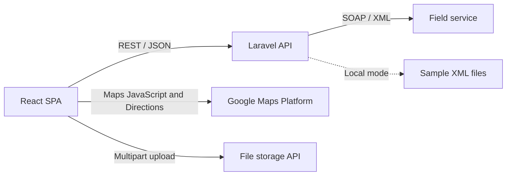

<p align="center">
  
</p>

<h1 align="center">Georeferenced Routes Supervisor</h1>

<p align="center">
  Field incident verification and route supervision for operations teams.
</p>

<p align="center">
  
  
  
  
</p>

## Overview

Georeferenced Routes Supervisor is a mobile-first web application for teams that inspect reported incidents on site. Each verifier receives a queue of geolocated incidents, follows an optimized driving route, records findings and photos at each stop, and sends the result to the central system.

The application is an off-the-shelf product. It connects to any system of record that exposes the SOAP service it consumes, and it ships with a local mode backed by fictional sample data.

## Features

- **Assigned incident queue:** download incidents with their address, reason, priority, and coordinates.
- **Route planning:** show pending incidents on Google Maps and compute an optimized driving route from the verifier's current position.
- **Field verification:** record the verified reason, task, urgency, and observations for each incident.
- **Photo evidence:** attach JPEG photos, which are compressed in the browser to at most 1 MB and 1920 px before upload.
- **Connectivity tolerance:** save an incident locally when the central system is unavailable and send it later.
- **Incident locking:** release incidents assigned to a verifier so that they can be reassigned.
- **Token-based sessions:** validate users against the central system and store the session token encrypted in the browser.

## Architecture



The Laravel API is a gateway. It translates REST calls into SOAP operations and returns normalized JSON to the frontend. `FieldServiceCommunications` contains all of the integration with the field service.

## Tech stack

| Layer | Technology |
| --- | --- |
| Frontend | React 18, React Router 6, Bootstrap 5, Sass, Google Maps JavaScript API |
| Backend | PHP 8.3, Laravel 11, Sanctum, SOAP |
| Infrastructure | Docker, Docker Compose, Nginx, Apache |
| CI/CD | GitLab CI pipelines in `devops/ci-cd` |

## Getting started

### Prerequisites

- Docker with Docker Compose
- A Google Maps API key with the Maps JavaScript API and Directions API enabled

### Run with Docker

1. Create the backend environment file:

   ```bash
   cp api/.env.example api.env
   ```

2. Set `APP_KEY` in `api.env` to the output of this command:

   ```bash
   echo "base64:$(openssl rand -base64 32)"
   ```

3. Create `ui.env` in the project root:

   ```env
   API_URL=http://localhost:8000/api/v1/verificaciones/
   GOOGLE_MAPS_API_KEY=your-google-maps-api-key
   ```

4. Build and start the containers:

   ```bash
   docker compose up -d --build
   ```

The UI is available at <http://localhost> and the API at <http://localhost:8000>.

### Local mode

When `FIELD_SERVICE_LOCAL=true`, the API reads fictional sample responses from `api/public/xmls_local` and does not need a field service. Sign in with these demo credentials:

| User | Password |
| --- | --- |
| `desarrollo` | `123456` |

These credentials work only in local mode.

## Configuration

| Variable | File | Description |
| --- | --- | --- |
| `API_URL` | `ui.env` | Base URL of the REST API used by the frontend |
| `GOOGLE_MAPS_API_KEY` | `ui.env` | Google Maps API key for the routes map |
| `MAPS_MAP_ID` | `.env` | Optional vector map ID that enables map rotation and tilt in development |
| `APP_KEY` | `api.env` | Laravel application key |
| `VF_URL` | `api.env` | Base URL of the SOAP field service |
| `FIELD_SERVICE_LOCAL` | `api.env` | Use the sample XML files instead of the SOAP service |
| `CORS_ALLOWED_ORIGINS` | `api.env` | Origins allowed to call the API |
| `REACT_APP_TOKEN_KEY` | build environment | Key used to encrypt the session token in the browser |
| `REACT_APP_ARCHIVOS_API_URL` | build environment | Base URL of the file storage API |

## API

All endpoints use the `/api/v1/verificaciones` prefix, except for the general health check at `/api/healthcheck`.

| Method | Path | Description |
| --- | --- | --- |
| `POST` | `/usuario/token` | Sign in and get a token |
| `POST` | `/usuario/token/validar` | Validate a token |
| `GET` | `/incidentes` | Download the incidents assigned to a verifier |
| `GET` | `/incidentes/imagen` | Get an incident image |
| `POST` | `/incidentes/unlock` | Release the incidents assigned to a verifier |
| `POST` | `/verificacion/cargar` | Save a verification |
| `POST` | `/verificacion/finalizar` | Finish a verification |
| `GET` | `/parametricas` | Download reason and task catalogs |
| `GET` | `/field-service/healthcheck` | Check connectivity with the field service |

A Postman collection is available in [`docs/`](docs/).

## Project structure

```text
.
├── api/                Laravel REST API and SOAP gateway
│   ├── app/Http/       Controllers and middleware
│   ├── app/Lib/        Field service client
│   └── public/xmls_local/  Sample responses for local mode
├── ui/                 React single-page application
│   ├── public/         Static assets and logo
│   └── src/            Views, components, services, and styles
├── devops/             Dockerfiles, CI/CD pipelines, and deployment templates
├── docs/               Postman collection
├── docker-compose.yml
└── test_api.sh         End-to-end API smoke tests
```

## Testing

Run the API smoke tests against a running instance:

```bash
./test_api.sh http://localhost:8000 local
```

To test against a real field service, pass `prod` as the mode and provide credentials through the environment:

```bash
API_LOGIN=your-user API_PASSWORD=your-password ./test_api.sh https://api.example.com prod
```

## License

Copyright. All rights reserved.
